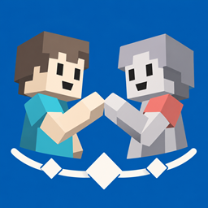

<div align="center">



# AnimCue (合拍)

**Shared multi-actor interactive animation runtime for Minecraft entities, items, and blocks.**

[English](README.md) | [简体中文](README_zh.md) · [Wiki (EN)](docs/wiki/Home.md) | [Wiki (中文)](docs/wiki/Home_zh.md)

</div>

---

## Overview

**AnimCue** (mod ID: `interactive_animation`) is a multi-loader, multi-version Minecraft library that plays synchronized interactive animation scenes across multiple participants—such as players, mobs, vehicles, items, blocks, and custom models—from a single Bedrock-format animation JSON file.

Author multi-participant scenes on a shared timeline (including root displacement, bone transforms, bend curves, camera tracks, and timeline markers), then trigger them from server or client code with automatic spatial alignment, movement/AI control leases, and multiplayer synchronization.

- **Mod ID**: `interactive_animation`
- **License**: [LGPL-3.0-or-later](LICENSE)
- **Showcase Addon**: [Superb Warfare: Boarding](https://github.com/kltyton/SuperbWarfare-Boarding) — animated vehicle boarding and dismounting built on AnimCue.

---

## Supported Platforms

| Minecraft | Fabric | NeoForge | Forge | Player Animation Layer |
| --- | :---: | :---: | :---: | --- |
| **26.2** | Yes | Yes | — | PAL + PAL More Rotation (optional) |
| **26.1.2** | Yes | Yes | — | PAL + PAL More Rotation (optional) |
| **1.21.1** | Yes | Yes | — | PAL + PAL More Rotation (optional) |
| **1.20.1** | Yes | — | Yes | Native / Bendy adapters (optional) |

---

## Core Features

- **Single-File Bedrock Extension (`interactive_animation:interactions`)**: Add a top-level `interactive_animation:interactions` block to standard GeckoLib, PAL, or Bedrock animation JSON files. Up to 64 participants per scene, keyed by the primary animation name.
- **Root & Bone Channels**: Drive whole-actor motion via `interactive_animation:root` (16 model units = 1 block, unbounded degree rotations) alongside standard per-bone `position`, `rotation`, `scale`, and `bend` channels with `linear` or `catmullrom` interpolation.
- **Ordered & Named Bindings + Bone Remapping**: Bind live `Entity`, `ItemStack`, or `BlockState` instances by role name or array order, with optional authored-to-model bone remapping (`Bindings#mapBones`).
- **Alignment, Path Checks & Controls**: Configure snap/transition alignment tolerances, optional approach path checks, world-coordinate handoff (`SceneHandle#useWorldCoordinates`), carrier following, and reference-counted AI/movement/attack/interaction leases (`AnimationControls`).
- **Camera Tracks & Modes**: Optional per-scene `camera` track plus `AUTO`, `VANILLA`, `FOLLOW`, and `LOCKED` camera modes.
- **Ecosystem Integration**: Hooks cleanly into GeckoLib 4 & 5 (`GeckoSubjects`), PAL & PAL More Rotation, KBR renderers, and vanilla Minecraft models.

---

## Quick Start

### 1. Define a Scene in JSON

Add `interactive_animation:interactions` at the top level of your animation file:

```json
{
  "format_version": "1.8.0",
  "animations": {
    "animation.dragon.grab": {
      "animation_length": 1.2,
      "bones": {},
      "timeline": {
        "0.25": "grab",
        "0.6": "release"
      }
    }
  },
  "interactive_animation:interactions": {
    "animation.dragon.grab": {
      "participants": [
        {
          "role": "victim",
          "type": "entity",
          "id": "minecraft:player",
          "bones": {
            "interactive_animation:root": {
              "position": { "0.0": [0, 0, -16], "0.6": [0, 16, -16], "1.2": [0, 0, -80] },
              "rotation": { "0.6": [0, 0, 0], "1.2": [0, 0, 720] }
            },
            "head": {
              "rotation": { "0.25": [15, 0, 0] }
            }
          }
        }
      ]
    }
  }
}
```

### 2. Register & Play from Java

Register the packaged animation asset during mod initialization so the server loads the same file the client reads from resource packs:

```java
InteractiveScenes.register(OwnerMod.class, "example:geckolib/animations/dragon.animation.json");
```

Trigger the scene on the server:

```java
var id = new SceneId("example:geckolib/animations/dragon.animation.json", "animation.dragon.grab");
var subject = GeckoSubjects.entity(dragon, "skills", "grab", transitionTicks);
var options = PlaybackOptions.DEFAULT
        .alignment(true, true, 0.0625, result -> {
            if (!result.aligned()) playMissAnimation(result);
        })
        .markers(marker -> {
            if (marker.instruction().equals("release")) {
                marker.playback().useWorldCoordinates("victim");
            }
        });

InteractiveScenes.play(subject, id, Bindings.named(Map.of("victim", player)), options);
```

For local client-only previews, call `ClientScenes.playLocal(subject, id)`.

---

## Maven Dependency

Add the Sighs Maven repository to your `build.gradle`:

```groovy
repositories {
    maven {
        name = "Sighs Maven"
        url = uri("https://maven.sighs.cc/repository/maven-public/")
    }
}

dependencies {
    // Replace <loader>-<mc> with your target, e.g. neoforge-1.21.1, fabric-1.21.1, forge-1.20.1, fabric-26.2
    implementation "com.kltyton:interactive_animation-<loader>-<mc>:0.1.1"
}
```

---

## Documentation (Wiki)

Full documentation is available in both English and Chinese inside [`docs/wiki/`](docs/wiki/Home.md):

| Topic | English | 简体中文 |
| --- | --- | --- |
| Wiki Home | [Home](docs/wiki/Home.md) | [首页](docs/wiki/Home_zh.md) |
| Getting Started | [Getting Started](docs/wiki/en/Getting-Started.md) | [快速开始](docs/wiki/zh/快速开始.md) |
| Animation JSON Format | [Animation Format](docs/wiki/en/Animation-Format.md) | [动画格式规范](docs/wiki/zh/动画格式规范.md) |
| Playback & Binding API | [Playback API](docs/wiki/en/Playback-API.md) | [播放与绑定 API](docs/wiki/zh/播放与绑定API.md) |
| Client Rendering & Camera | [Client Rendering & Camera](docs/wiki/en/Client-Rendering-and-Camera.md) | [客户端渲染与镜头](docs/wiki/zh/客户端渲染与镜头.md) |
| Building & Architecture | [Building & Architecture](docs/wiki/en/Building-and-Architecture.md) | [构建与多版本架构](docs/wiki/zh/构建与多版本架构.md) |

---

## Building from Source

The repository uses a KltytonTemple multi-target Gradle layout (`common/src/main` for shared scene logic, `common/src/compat` for version/loader adapters, and `targets/<loader>-<mc>` for each target build).

Build any target from its subdirectory:

```bash
cd targets/neoforge-1.21.1
../../gradlew build
```

Pass `-PanimationCompatibility=true` when running development environments with supported PAL / PAL More Rotation dependencies.

---

## License

AnimCue is licensed under the **GNU Lesser General Public License v3.0 or later** ([LGPL-3.0-or-later](LICENSE)).
