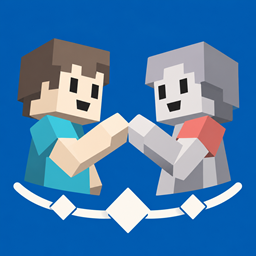

<div align="center">



# 合拍 · AnimCue

**面向 Minecraft 实体、物品与方块的共享多参与者互动动画运行库。**

[English](README.md) | [简体中文](README_zh.md) · [Wiki (EN)](docs/wiki/Home.md) | [Wiki (中文)](docs/wiki/Home_zh.md)

</div>

---

## 简介

**合拍（AnimCue）**（模组 ID：`interactive_animation`）是一个跨版本、跨加载器的 Minecraft 互动动画运行库，可通过单个 Bedrock 动画 JSON 文件，在玩家、生物、载具、物品、方块和自定义模型等多个参与者之间同步播放完整的互动演出。

创作者可以在同一时间轴上编排整体位移、骨骼变换、弯曲曲线、独立镜头与时间轴事件，再通过简洁的服务端或客户端 API 触发播放，自动完成空间对位、移动与 AI 控制权托管以及联机状态同步。

- **模组 ID**：`interactive_animation`
- **开源协议**：[LGPL-3.0-or-later](LICENSE)
- **实装演示附属**：[卓越前线：登乘演出（Superb Warfare: Boarding）](https://github.com/kltyton/SuperbWarfare-Boarding) — 基于合拍实现的卓越前线载具上下车演出模组。

---

## 支持版本与加载器

| Minecraft 版本 | Fabric | NeoForge | Forge | 玩家动画层 |
| --- | :---: | :---: | :---: | --- |
| **26.2** | 支持 | 支持 | — | PAL + PAL More Rotation（可选） |
| **26.1.2** | 支持 | 支持 | — | PAL + PAL More Rotation（可选） |
| **1.21.1** | 支持 | 支持 | — | PAL + PAL More Rotation（可选） |
| **1.20.1** | 支持 | — | 支持 | 原版模型通道 / 弯曲适配（可选） |

---

## 核心特性

- **单文件 Bedrock 扩展（`interactive_animation:interactions`）**：直接写入现有 GeckoLib、PAL 或 Bedrock 动画 JSON 顶层，以主动画名关联最多 64 个参与者。
- **整体与关节轨道**：使用 `interactive_animation:root` 驱动整体位移与旋转（16 模型单位 = 1 格，旋转角度支持超过 360°），普通骨骼支持 `position`、`rotation`、`scale`、`bend` 四类通道及 `linear` / `catmullrom` 插值。
- **按名 / 按序绑定与骨骼映射**：可将世界中的 `Entity`、`ItemStack` 或 `BlockState` 按角色名或数组顺序绑定到参与者，并支持「动画骨骼名 → 实际模型骨骼名」重映射（`Bindings#mapBones`）。
- **对位、路径检查与控制权托管**：支持无过渡直对位、对位容差回调、路径可达性检查、世界坐标脱手（`SceneHandle#useWorldCoordinates`）、载体跟随以及引用计数式的 AI / 移动 / 攻击 / 交互控制权锁（`AnimationControls`）。
- **独立镜头轨道与模式**：支持与 `participants` 同级的 `camera` 轨道，提供 `AUTO`、`VANILLA`、`FOLLOW`、`LOCKED` 四种镜头模式。
- **时间轴、声音与粒子关键帧**：除主动画 `timeline` 指令事件外，还支持主体与参与者轨道上的 `sound_effects` 与 `particle_effects` 关键帧（支持自定义回调拦截与自动播放）。
- **生态兼容**：原生适配 GeckoLib 4 与 5（`GeckoSubjects`）、PAL 与 PAL More Rotation、KBR 渲染器及原版模型渲染。

---

## 快速开始

### 1. 编写互动动画 JSON

在标准动画 JSON 顶层添加 `interactive_animation:interactions`：

```json
{
  "format_version": "1.8.0",
  "animations": {
    "animation.dragon.grab": {
      "animation_length": 1.2,
      "bones": {},
      "timeline": {
        "0.25": "grab",
        "0.6": "release"
      }
    }
  },
  "interactive_animation:interactions": {
    "animation.dragon.grab": {
      "participants": [
        {
          "role": "victim",
          "type": "entity",
          "id": "minecraft:player",
          "bones": {
            "interactive_animation:root": {
              "position": { "0.0": [0, 0, -16], "0.6": [0, 16, -16], "1.2": [0, 0, -80] },
              "rotation": { "0.6": [0, 0, 0], "1.2": [0, 0, 720] }
            },
            "head": {
              "rotation": { "0.25": [15, 0, 0] }
            }
          }
        }
      ]
    }
  }
}
```

### 2. 注册并触发播放

在模组初始化时注册服务端资源，客户端会自动从资源包读取同一路径的动画文件：

```java
InteractiveScenes.register(OwnerMod.class, "example:geckolib/animations/dragon.animation.json");
```

在服务端触发互动场景：

```java
var id = new SceneId("example:geckolib/animations/dragon.animation.json", "animation.dragon.grab");
var subject = GeckoSubjects.entity(dragon, "skills", "grab", transitionTicks);
var options = PlaybackOptions.DEFAULT
        .alignment(true, true, 0.0625, result -> {
            if (!result.aligned()) playMissAnimation(result);
        })
        .markers(marker -> {
            if (marker.instruction().equals("release")) {
                marker.playback().useWorldCoordinates("victim");
            }
        });

InteractiveScenes.play(subject, id, Bindings.named(Map.of("victim", player)), options);
```

若仅需在客户端本地预览缺省素材或本地绑定实例，可使用 `ClientScenes.playLocal(subject, id)`。

---

## Maven 依赖接入

在 `build.gradle` 中添加 Sighs Maven 仓库与对应目标坐标：

```groovy
repositories {
    maven {
        name = "Sighs Maven"
        url = uri("https://maven.sighs.cc/repository/maven-public/")
    }
}

dependencies {
    // 将 <loader>-<mc> 替换为实际目标，例如 neoforge-1.21.1、fabric-1.21.1、forge-1.20.1、fabric-26.2
    implementation "com.kltyton:interactive_animation-<loader>-<mc>:0.1.2"
}
```

---

## 示例工程

仓库根目录的 [`examples/`](examples/README.md) 提供了独立的美术示例工程（`.bbmodel`）与导出的 `.animation.json`（不打包进库本体的发行 `.jar`）。使用说明请参阅 [示例工程与动画参考](docs/wiki/zh/示例工程与动画参考.md)。

---

## 完整文档（Wiki）

完整中英文开发手册位于 [`docs/wiki/`](docs/wiki/Home_zh.md)：

| 主题 | 简体中文 | English |
| --- | --- | --- |
| Wiki 首页 | [首页](docs/wiki/Home_zh.md) | [Home](docs/wiki/Home.md) |
| 快速开始 | [快速开始](docs/wiki/zh/快速开始.md) | [Getting Started](docs/wiki/en/Getting-Started.md) |
| 动画格式规范 | [动画格式规范](docs/wiki/zh/动画格式规范.md) | [Animation Format](docs/wiki/en/Animation-Format.md) |
| 播放与绑定 API | [播放与绑定 API](docs/wiki/zh/播放与绑定API.md) | [Playback API](docs/wiki/en/Playback-API.md) |
| 客户端渲染与镜头 | [客户端渲染与镜头](docs/wiki/zh/客户端渲染与镜头.md) | [Client Rendering & Camera](docs/wiki/en/Client-Rendering-and-Camera.md) |
| 示例工程参考 | [示例工程与动画参考](docs/wiki/zh/示例工程与动画参考.md) | [Examples](docs/wiki/en/Examples.md) |
| 构建与多版本架构 | [构建与多版本架构](docs/wiki/zh/构建与多版本架构.md) | [Building & Architecture](docs/wiki/en/Building-and-Architecture.md) |

---

## 从源码构建

工程按 KltytonTemple 多目标结构组织：共享场景逻辑位于 `common/src/main`，版本与加载器差异位于 `common/src/compat`，各目标构建位于 `targets/<loader>-<mc>`。

进入对应目标目录执行 Gradle Wrapper：

```bash
cd targets/neoforge-1.21.1
../../gradlew build
```

在支持 PAL 的目标上调试兼容环境时，可附加 `-PanimationCompatibility=true`。

---

## 开源协议

本项目基于 **GNU Lesser General Public License v3.0 or later**（[LGPL-3.0-or-later](LICENSE)）发布。
